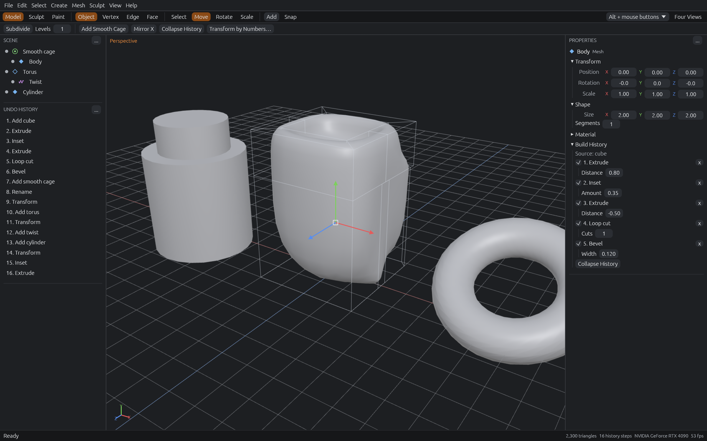
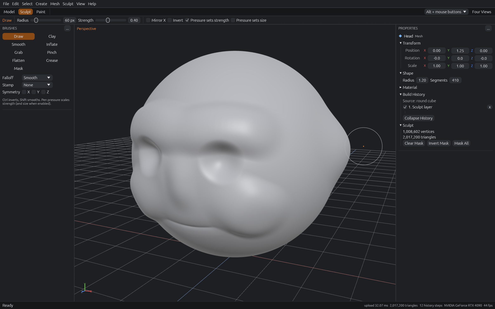

<p align="center">
  
</p>

<h1 align="center">ModelCraft</h1>

<p align="center"><b>3D modeling and sculpting, in pure Rust.</b></p>

<p align="center">
ModelCraft is an open-source 3D content-creation app, one of the Crafting Apps. Build shapes from
parametric primitives with an editable build history, wrap them in smooth cages and deformers, then
sculpt million-polygon meshes with symmetric brushes and masks, and hand the result to TextureCraft,
MaterialCraft or ArtCraft as glTF.
</p>

<p align="center">
  
  
  
  
</p>

> [!NOTE]
> ModelCraft is proposed to the ArtCraft team as the suite's modeler: the Crafting Apps have node
> materials (MaterialCraft) and 3D texture painting (TextureCraft) but nothing to make the meshes
> they work on. This is a vertical slice: the core is complete and tested, the toolset is the
> essentials. See [ROADMAP.md](ROADMAP.md) and the honest [parity assessment](docs/target-app-parity.md).





[What works today](#what-works-today) · [Getting started](#getting-started) · [Agents, CLI](#agents-and-cli) ·
[Roadmap](#roadmap) · [The Crafting Apps](#the-crafting-apps) · [License and credits](#license-and-credits)

## What works today

- **Parametric primitives.** Cube, plane, sphere, quad sphere, cylinder, cone and torus; change their
  parameters any time.
- **Build history.** Extrude, inset, bevel, loop cut, merge, weld, delete, move/rotate/scale
  components, flip, triangulate and subdivide are steps you can edit, switch off or remove later;
  everything after the change re-runs. Collapse bakes the history into the mesh.
- **Smooth cages and deformers.** A smooth cage shows its child subdivided (0–6 levels); bend,
  twist, taper, ripple and round deformers work as children of the mesh they shape.
- **Polygon editing.** Vertex, edge and face modes, click and box selection, edge loops and rings,
  grow/shrink, move/rotate/scale gizmos with snapping, Transform by Numbers for every gizmo action,
  and bridge, fill hole and mirror as history steps.
- **Sculpting.** Draw, clay, smooth, inflate, grab, pinch, flatten, crease and mask brushes with
  falloff curves, stamps, X/Y/Z symmetry and pen pressure on meshes of a million polygons and more
  (about 280 fps while sculpting two million triangles on an RTX 4090; see
  [docs/performance.md](docs/performance.md)).
- **Your work is safe.** Atomic saves, a journal of every command (sculpt strokes included) that
  replays after a crash, autosave for untitled scenes, a Save / Don't Save / Cancel prompt before
  anything discards changes, Save Incremental, Open Recent, and unlimited undo within a memory
  budget with an Undo History panel to jump to any step.
- **Your keys.** Every command can be rebound in the suite's Keyboard Shortcuts dialog, with
  conflict detection; workspace-only keys never collide across modes.
- **Exchange.** glTF/GLB, OBJ and STL in and out, PLY in, through the shared `craft-mesh` crate (Y up,
  metres, UVs, materials, hierarchy).
- **Professional layout.** Dense dark theme; Model, Sculpt and Paint workspaces; panels you can dock
  left or right, float or hide; tool options bar; single or four views; three navigation presets.
- **Accessible.** Every command has a shortcut or the command palette (Ctrl+K); the scene tree and the
  viewport's objects are in the accessibility tree; kittest tests drive the main flows by keyboard.

## Getting started

```bash
cargo run --release -p modelcraft -- --demo model
cargo run --release -p modelcraft -- --demo sculpt
```

| Keys | Action |
|---|---|
| Ctrl+K | command palette (every command) |
| Ctrl+1 / 2 / 3 | Model / Sculpt / Paint workspace |
| 1 2 3 4 | object / vertex / edge / face mode (Model) |
| Q W E R | select / move / rotate / scale |
| Shift+E, Shift+I, Shift+B, Shift+L, Shift+M, Shift+D | extrude, inset, bevel, loop cut, merge, subdivide |
| Shift+G, Shift+F, Shift+X | bridge two faces, fill hole, mirror X |
| Alt+L (or double-click), Alt+R, Ctrl+= / Ctrl+- | edge loop, edge ring, grow / shrink selection |
| Shift+S, Ctrl while dragging | snapping on/off, invert snapping for one drag |
| Ctrl+Alt+S, Ctrl+Alt+K | save incremental (`_v002`…), keyboard shortcuts editor |
| Ctrl+T | Transform by Numbers |
| D C S I G P L K M | draw, clay, smooth, inflate, grab, pinch, flatten, crease, mask brush (Sculpt) |
| [ ] , X | brush size, X symmetry |
| Ctrl / Shift while sculpting | invert / smooth |
| Alt + left / middle / right drag | orbit / pan / zoom (other presets in View ▸ Navigation) |
| Arrow keys, Shift+arrows, + / − | orbit, pan, zoom the focused view |
| Space, F, Alt+1..4 | four views, frame selection, perspective/front/right/top |
| F2, Ctrl+D, Delete, F6 | rename, duplicate, delete, next panel |
| Ctrl+Z, Ctrl+Shift+Z | undo, redo |

Optional build inputs (never Cargo dependencies), as in the other Craft apps:

```bash
CRAFT_I18N_DIR=$PWD/../craft-i18n CRAFT_FONTS_DIR=$PWD/../craft-fonts cargo run --release -p modelcraft
```

Checks before every commit:

```bash
cargo xtask ci     # fmt, clippy -D warnings, tests, layering, assets, licences, progress fragments
```

## Agents and CLI

Every action is an engine command; `modelcraft-cli` runs them in batches or over a JSON-lines
channel, and converts, validates and benchmarks models:

```bash
cargo run --release -p modelcraft-cli -- exec scene.modelcraft '{"cmd":"add_primitive","kind":"torus"}'
cargo run --release -p modelcraft-cli -- convert model.obj model.glb
cargo run --release -p modelcraft-cli -- bench --polys 1000000
```

Reference: [docs/cli.md](docs/cli.md).

## Roadmap

[ROADMAP.md](ROADMAP.md) (stage and numbers), [docs/roadmap.md](docs/roadmap.md) (milestones),
[docs/gaps.md](docs/gaps.md) (ranked work list), [docs/target-app-parity.md](docs/target-app-parity.md).

## The Crafting Apps

ModelCraft makes the meshes the rest of the suite works on: paint them in TextureCraft, give them
node materials in MaterialCraft, stage them in ArtCraft. They share libraries through
[storytold/craft-libs](https://github.com/storytold/craft-libs).

## License and credits

MIT OR Apache-2.0 ([LICENSE-MIT](LICENSE-MIT), [LICENSE-APACHE](LICENSE-APACHE)); see
[NOTICE](NOTICE) and [ATTRIBUTION.md](ATTRIBUTION.md). ModelCraft is a clean-room project and is not
affiliated with the makers of any commercial 3D application.
